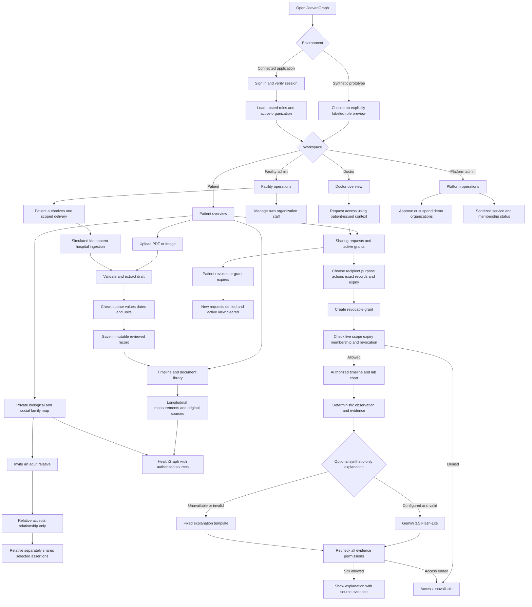
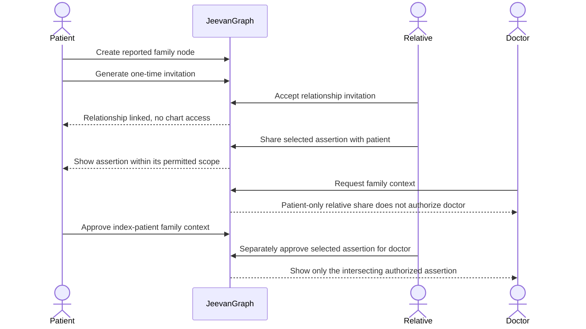

# JeevanGraph website flow

## Role entry and the complete journey

## Family access boundary

## Guardrails

- Prototype role selection is a navigation aid, not authentication.
- A facility connection permits scoped ingestion, not unrestricted chart access.
- A platform administrator manages operations, not every patient's medical data.
- Accepting a family invitation grants no clinical access.
- Upload review confirms transcription, not a diagnosis or clinical validity.
- Explanations require the same evidence permissions as the underlying records.
- All prototype records are fictional. Real hospital, ABDM and ABHA integration are outside this release.
